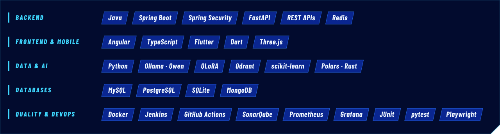

 

 

I'm **Jasser**, a final-year software engineering student at **ESPRIT** in Tunis.
I build full-stack and mobile applications, plug **local AI models** into real products with proper safeguards, and test what I ship.

- 🎯 **Looking for:** a 4–6 month **PFE internship**, starting early 2027
- 🛠️ **Right now:** Flutter apps that work offline, and LLM features that fail safely
- 🧪 **I care about:** clear architecture, honest measurements, and tests that prove it works
- 🌍 **Languages:** Arabic (native) · French · English

 

<table>
  <tr>
    <td width="50%" valign="top">
      
       <b>AI car-parts marketplace</b> — Spring Boot · Angular · FastAPI · Qdrant · local Qwen 2.5 (QLoRA), with circuit breakers so browsing survives when the AI is down.
    </td>
    <td width="50%" valign="top">
      
       <b>Hotel housekeeping app</b> — Flutter · Dart · SQLite with 7 versioned migrations, event-based modules, and a 43-step end-to-end test on a real Android phone.
    </td>
  </tr>
  <tr>
    <td width="50%" valign="top">
      
       <b>Restaurant platform with local AI</b> — Angular · FastAPI · Ollama · scikit-learn. Allergy-aware recommendations with a rule-based fallback; demand forecasting.
    </td>
    <td width="50%" valign="top">
      
       <b>Analytical databases in Rust</b> — Polars vs PostgreSQL on 67M rows, plus semantic and image search over 6,000+ photos with Qdrant and CLIP.
    </td>
  </tr>
</table>

<a href="https://jassernoomani.github.io/#work"><b>▶ See demos, screenshots and details on my portfolio</b></a>

 

 

Recruiting for a PFE, working on something in this space, or just curious about a project? Reach me at **[Jasser.NOOMANI@esprit.tn](mailto:Jasser.NOOMANI@esprit.tn)** or on **[LinkedIn](https://www.linkedin.com/in/jasser-noomani)**. You can also download my CV from the [portfolio](https://jassernoomani.github.io).

