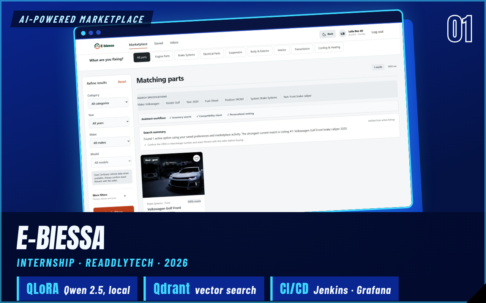
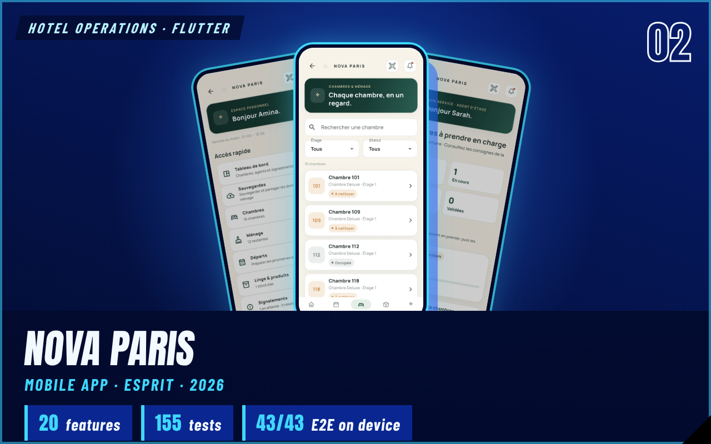
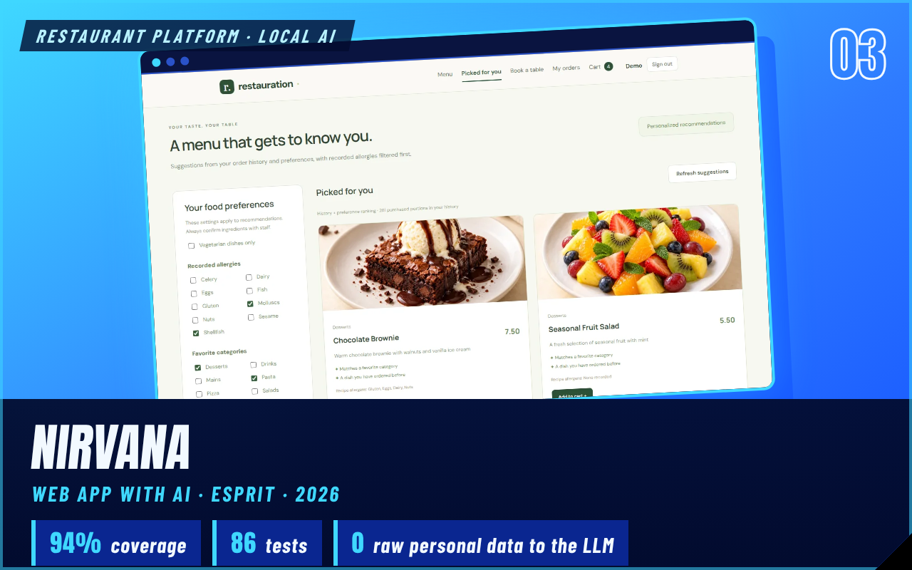
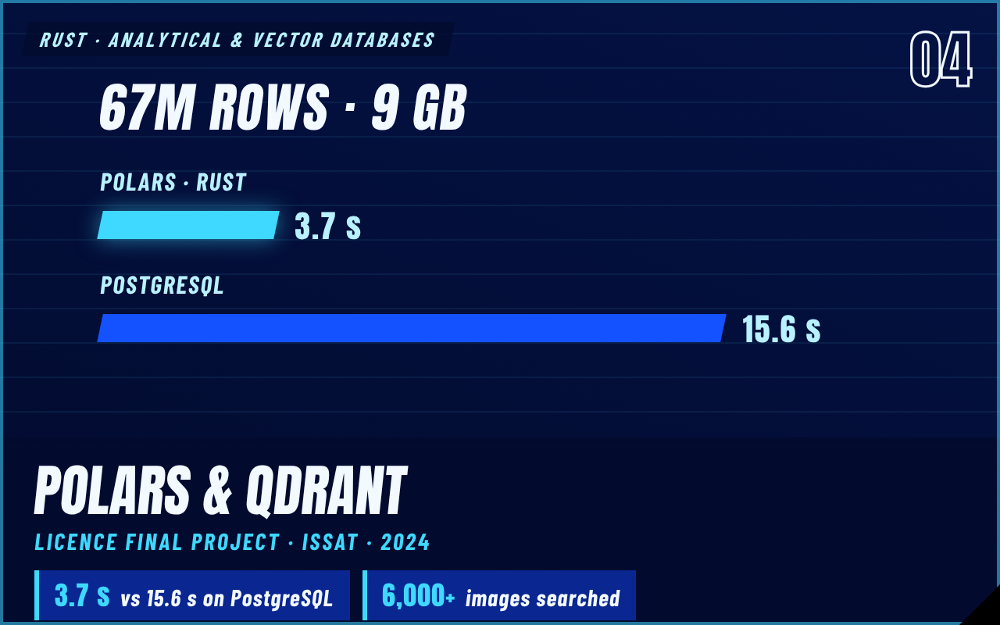

<!-- Header: animated wave (capsule-render) -->
<p align="center">
  
</p>

<!-- Typing headline -->
<p align="center">
  <a href="https://jassernoomani.github.io">
    
  </a>
</p>

<!-- Social badges -->
<p align="center">
  <a href="https://jassernoomani.github.io"></a>
  <a href="https://www.linkedin.com/in/jasser-noomani"></a>
  <a href="mailto:Jasser.NOOMANI@esprit.tn"></a>
  <a href="https://jassernoomani.github.io/Jasser_Noomani_CV_Fr.pdf"></a>
  
</p>

---

## 👋 About me

```yaml
name:      Jasser Noomani
role:      Software engineering student — ESPRIT, Tunis (2024 → present)
focus:     [Full-stack, Mobile, Applied AI]
looking_for: 4–6 month PFE internship, starting early 2027
right_now:
  - Flutter apps that keep working offline
  - LLM features with guardrails and graceful fallbacks
i_care_about: [clean architecture, honest benchmarks, tests that prove it works]
languages: { Arabic: native, French: B2, English: B2 }
```

---

## 🛠️ Toolkit

<p align="center"><b>Backend</b><br/>
  
</p>
<p align="center"><b>Frontend &amp; Mobile</b><br/>
  
</p>
<p align="center"><b>Data, AI &amp; Databases</b><br/>
  
  <br/>
  
  
  
  
  
</p>
<p align="center"><b>Quality &amp; DevOps</b><br/>
  
  <br/>
  
  
  
  
</p>

---

## 🚀 Featured work

<table>
  <tr>
    <td width="50%" valign="top">
      <a href="https://jassernoomani.github.io/#work"></a>
      <br /><b>e-Biessa — AI car-parts marketplace</b><br />Spring Boot · Angular · FastAPI · Qdrant · local Qwen 2.5 (QLoRA), with circuit breakers so browsing keeps working when the AI is down.
    </td>
    <td width="50%" valign="top">
      <a href="https://jassernoomani.github.io/#work"></a>
      <br /><b>Nova Paris — hotel housekeeping app</b><br />Flutter · Dart · SQLite with 7 versioned migrations, event-based modules and a 43-step end-to-end test on a real Android phone.
    </td>
  </tr>
  <tr>
    <td width="50%" valign="top">
      <a href="https://jassernoomani.github.io/#work"></a>
      <br /><b>Nirvana — restaurant platform with local AI</b><br />Angular · FastAPI · Ollama · scikit-learn. Allergy-aware recommendations with a rule-based fallback, plus demand forecasting.
    </td>
    <td width="50%" valign="top">
      <a href="https://jassernoomani.github.io/#work"></a>
      <br /><b>Analytical databases in Rust</b><br />Polars vs PostgreSQL on 67M rows (3.7 s vs 15.6 s), plus semantic and image search over 6,000+ photos with Qdrant and CLIP.
    </td>
  </tr>
</table>

<p align="center"><a href="https://jassernoomani.github.io/#work"><b>▶ Demos, screenshots and details on my portfolio</b></a></p>

---

## 📊 GitHub stats

<p align="center">
  
  
</p>
<p align="center">
  
</p>
<p align="center">
  
</p>

<!-- Snake eating the contribution grid (generated by .github/workflows/snake.yml) -->
<p align="center">
  <picture>
    <source media="(prefers-color-scheme: dark)" srcset="https://raw.githubusercontent.com/jassernoomani/jassernoomani/output/snake-dark.svg" />
    <source media="(prefers-color-scheme: light)" srcset="https://raw.githubusercontent.com/jassernoomani/jassernoomani/output/snake-light.svg" />
    
  </picture>
</p>

---

## 📫 Let's talk

Recruiting for a PFE, working on something in this space, or curious about a project?
Reach me at **[Jasser.NOOMANI@esprit.tn](mailto:Jasser.NOOMANI@esprit.tn)** or on **[LinkedIn](https://www.linkedin.com/in/jasser-noomani)** — my CV is on the [portfolio](https://jassernoomani.github.io).

<!-- Footer wave -->
<p align="center">
  
</p>
